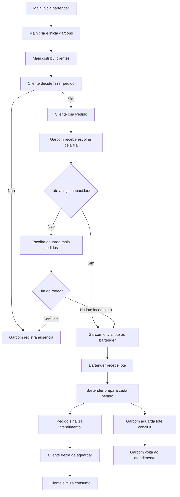

# Exercício 1 - Atendimento Concorrente no Bar

## Visão Geral

Esta atividade simula o atendimento de clientes em um bar por múltiplos garçons e um bartender. Clientes tomam decisões em várias rodadas, garçons agrupam os pedidos em lotes e o bartender prepara os itens de cada lote. O objetivo é exercitar comunicação e sincronização entre threads usando filas bloqueantes e sinais de conclusão.

## Tecnologias e Ferramentas

- Java;
- API padrão do Java;
- `Thread` para clientes, garçons e bartender;
- `BlockingQueue` e `LinkedBlockingQueue`;
- `CountDownLatch`;
- `Collections.unmodifiableList`;
- `ArrayDeque`, `ArrayList`, `HashMap` e `Map`;
- `ThreadLocalRandom`;
- Compilador `javac` e máquina virtual `java`.

Não há gerenciador de dependências ou framework externo configurado no projeto.

## Como foi Solucionado

### Coordenação principal

A classe `Main` valida os parâmetros opcionais e inicia o bartender, os garçons e os clientes:

- clientes: padrão 12;
- garçons: padrão 3;
- capacidade de cada lote: padrão 4;
- rodadas: padrão 5.

Os clientes são distribuídos em round-robin entre os garçons. A classe aguarda todos os clientes e garçons terminarem e interrompe as threads ainda ativas caso a demonstração seja encerrada.

### Classes e responsabilidades

`Cliente` é uma thread que, em cada rodada, decide aleatoriamente com 70% de probabilidade se fará um pedido. Quando faz, registra o `Pedido` no garçom associado e aguarda sua conclusão por meio do latch. Depois simula o consumo por um intervalo aleatório entre 300 e 1000 ms.

`Garcom` é uma thread que recebe escolhas em uma `LinkedBlockingQueue`, organiza pedidos por rodada e envia lotes ao bartender. Sua capacidade limita o número de pedidos por viagem. Quando uma escolha pertence a uma rodada futura, ela é guardada em um `HashMap` de filas até o processamento daquela rodada.

`Pedido` contém o nome do cliente e o número da rodada. Seu `CountDownLatch` permite que o cliente espere especificamente até o bartender concluir aquele pedido.

`Bartender` é uma thread que recebe lotes pela sua própria fila bloqueante. Para cada pedido preparado, chama `concluirAtendimento`; depois sinaliza a conclusão do lote inteiro, liberando o garçom que aguarda aquela viagem à copa.

O lote do bartender é convertido em uma lista imutável para impedir alterações do garçom enquanto o bartender processa os pedidos.

### Sincronização e fluxo

As filas bloqueantes evitam espera ocupada quando não existem escolhas ou lotes disponíveis. Os latches funcionam como uma barreira de conclusão individual: um para cada pedido e outro para cada lote. A transmissão em rodadas impede que o garçom processe escolhas fora da ordem esperada.

## Diagrama da Solução



## Como Executar

Execute os comandos a partir da raiz do repositório. É necessário ter Java e JDK configurados no `PATH`.

```powershell
java -version
javac -version
```

Compile o Exercício 1:

```powershell
$fontes = Get-ChildItem 'src\main\java\br\edu\sistemasdistribuidos\exercicio01atendimentobar' -Recurse -Filter '*.java' |
  ForEach-Object { $_.FullName }

javac -encoding UTF-8 -d out $fontes
```

Execute com os parâmetros padrão:

```powershell
java -cp out br.edu.sistemasdistribuidos.exercicio01atendimentobar.app.Main
```

É possível configurar clientes, garçons, capacidade do lote e rodadas nessa ordem:

```powershell
java -cp out br.edu.sistemasdistribuidos.exercicio01atendimentobar.app.Main 12 3 4 5
```
