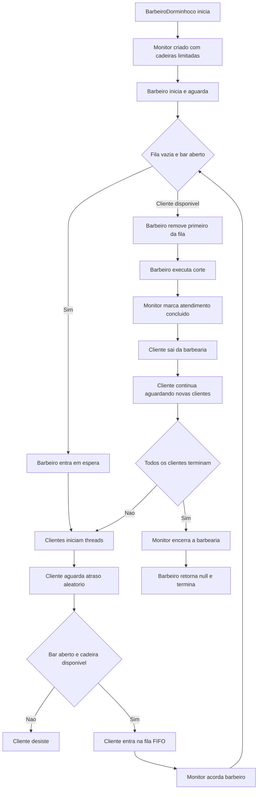

# Exercício 2 - Barbeiro Dorminhoco

## Visão Geral

Esta atividade simula o problema clássico do Barbeiro Dorminhoco. Um barbeiro atende clientes em uma fila limitada pela quantidade de cadeiras de espera; quando não há clientes, ele fica esperando. O objetivo é coordenar chegadas concorrentes, espera e término dos cortes sem condição de corrida.

## Tecnologias e Ferramentas

- Java;
- API padrão da plataforma;
- `Thread`;
- Monitor com `synchronized`, `wait()` e `notifyAll()`;
- `ArrayDeque` e `Queue`;
- `ThreadLocalRandom`;
- Compilador `javac` e máquina virtual `java`.

Não há gerenciador de dependências ou framework externo configurado no projeto.

## Como foi Solucionado

### Coordenação principal

A classe `BarbeiroDorminhoco` configura a barbearia e cria as threads:

- cadeiras de espera: padrão 3;
- clientes: padrão 10.

O barbeiro é iniciado antes dos clientes. Depois, uma thread é criada para cada cliente, com atraso aleatório de chegada entre 100 e 700 ms. A classe aguarda os clientes e sinaliza o fechamento da barbearia ao monitor.

`Main` é apenas o ponto de entrada usado pelo menu principal e delega a execução para `BarbeiroDorminhoco.main`.

### Monitor da barbearia

`BarbeariaMonitor` centraliza a fila FIFO e o estado compartilhado:

- `fila` guarda os atendimentos pendentes;
- `cadeirasDeEspera` limita o tamanho da sala de espera;
- `barbeiroDormindo` indica se o barbeiro entrou em espera;
- `encerrada` impede novos atendimentos após o fechamento;
- `Atendimento` associa o nome do cliente ao estado `concluido`.

O método `solicitarCorte` rejeita o cliente se a barbearia estiver fechada ou se todas as cadeiras estiverem ocupadas. Caso haja vaga, adiciona o cliente à fila, acorda o monitor e aguarda a conclusão do corte com `wait()`.

O método `aguardarProximoCliente` faz o barbeiro esperar enquanto a fila está vazia e o expediente continua aberto. Ao chegar um cliente, remove o primeiro atendimento da fila. Quando não há mais fila após o fechamento, retorna `null`.

O método `concluirCorte` marca o atendimento como concluído e executa `notifyAll` para liberar o cliente correspondente. Como todo o estado é protegido por `synchronized`, a fila e o estado do barbeiro são alterados em exclusão mútua.

### Threads

`Barbeiro` chama `aguardarProximoCliente` até receber `null`, simula um corte entre 400 e 1000 ms e conclui o atendimento no monitor.

`Cliente` espera antes de chegar à barbearia e tenta solicitar um corte. A mensagem de saída só é exibida após o atendimento ter sido concluído.

## Diagrama da Solução



## Como Executar

Execute os comandos a partir da raiz do repositório. É necessário ter Java e JDK configurados no `PATH`.

```powershell
java -version
javac -version
```

Compile o Exercício 2:

```powershell
$fontes = Get-ChildItem 'src\main\java\br\edu\sistemasdistribuidos\exercicio02barbeirodorminhoco' -Recurse -Filter '*.java' |
  ForEach-Object { $_.FullName }

javac -encoding UTF-8 -d out $fontes
```

Execute com os parâmetros padrão:

```powershell
java -cp out br.edu.sistemasdistribuidos.exercicio02barbeirodorminhoco.app.Main
```

É possível informar cadeiras de espera e quantidade de clientes nessa ordem:

```powershell
java -cp out br.edu.sistemasdistribuidos.exercicio02barbeirodorminhoco.app.Main 3 10
```
