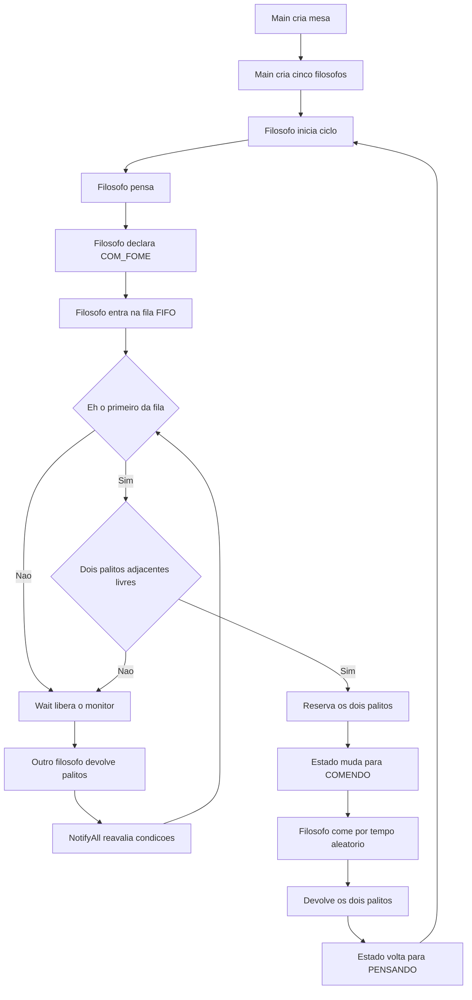

# Exercício 3 - Jantar dos Filósofos

## Visão Geral

Esta atividade simula o problema clássico do Jantar dos Filósofos. Cinco filósofos alternam entre pensar e comer, mas cada um necessita dos dois palitos adjacentes para comer. A solução coordena o acesso aos palitos compartilhados para evitar que os filósofos obtenham apenas um recurso e fiquem bloqueados indefinidamente.

## Tecnologias e Ferramentas

- Java;
- API padrão da plataforma;
- `Thread`;
- Monitor com `synchronized` e `wait`/`notifyAll`;
- `ArrayDeque` e `Deque`;
- `Arrays`;
- `ThreadLocalRandom`;
- `LocalTime` e `DateTimeFormatter`;
- Compilador `javac` e máquina virtual `java`.

Não há gerenciador de dependências ou framework externo configurado no projeto.

## Como foi Solucionado

### Coordenação principal

A classe `Main` cria uma mesa compartilhada e cinco threads `Filosofo`. A demonstração executa pelo tempo informado em segundos; sem argumento, usa 15 segundos.

Após o tempo definido, a classe solicita a interrupção de todos os filósofos e aguarda o término de cada thread. Se a própria thread principal for interrompida durante os joins, ela sinaliza novamente todas as threads antes de finalizar.

### Mesa e estados

`Mesa` centraliza os recursos compartilhados:

- um array de estados `EstadoFilosofo`;
- um array booleano indicando quais palitos estão disponíveis;
- uma `ArrayDeque` contendo os filósofos com fome em ordem FIFO.

`EstadoFilosofo` define `PENSANDO`, `COM_FOME` e `COMENDO`.

Cada filósofo possui um identificador de 0 a 4. O palito esquerdo é calculado com `(id - 1) mod 5` e o palito direito é o próprio `id`. O uso dos índices circulares representa corretamente a mesa fechada.

### Aquisição e devolução dos palitos

Em `solicitarPalitos`, o filósofo muda seu estado para `COM_FOME` e entra no fim da fila. A região é protegida por `synchronized`, e o método aguarda enquanto não for o primeiro da fila ou enquanto um dos dois palitos estiver ocupado.

Quando a condição é satisfeita, os dois palitos são reservados juntos e o estado muda para `COMENDO`. A reserva simultânea evita que um filósofo fique com um palito enquanto espera pelo outro.

Em `devolverPalitos`, os dois palitos voltam ao estado disponível, o filósofo volta a pensar e `notifyAll` acorda os demais para reavaliar a condição. Caso uma thread seja interrompida enquanto aguarda, ela é removida da fila, volta a pensar e preserva o sinal de interrupção.

### Threads filósofo

`Filosofo` alterna entre:

- meditar por um intervalo aleatório;
- solicitar os palitos na mesa;
- comer por outro intervalo aleatório;
- devolver os palitos no bloco `finally`.

Os intervalos variam entre 500 ms e 1999 ms. O bloco `finally` garante a devolução dos palitos caso a espera de alimentação seja interrompida.

## Diagrama da Solução



## Como Executar

Execute os comandos a partir da raiz do repositório. É necessário ter Java e JDK configurados no `PATH`.

```powershell
java -version
javac -version
```

Compile o Exercício 3:

```powershell
$fontes = Get-ChildItem 'src\main\java\br\edu\sistemasdistribuidos\exercicio03jantarfilosofos' -Recurse -Filter '*.java' |
  ForEach-Object { $_.FullName }

javac -encoding UTF-8 -d out $fontes
```

Execute com duração padrão de 15 segundos:

```powershell
java -cp out br.edu.sistemasdistribuidos.exercicio03jantarfilosofos.app.Main
```

Ou informe uma duração em segundos:

```powershell
java -cp out br.edu.sistemasdistribuidos.exercicio03jantarfilosofos.app.Main 10
```
