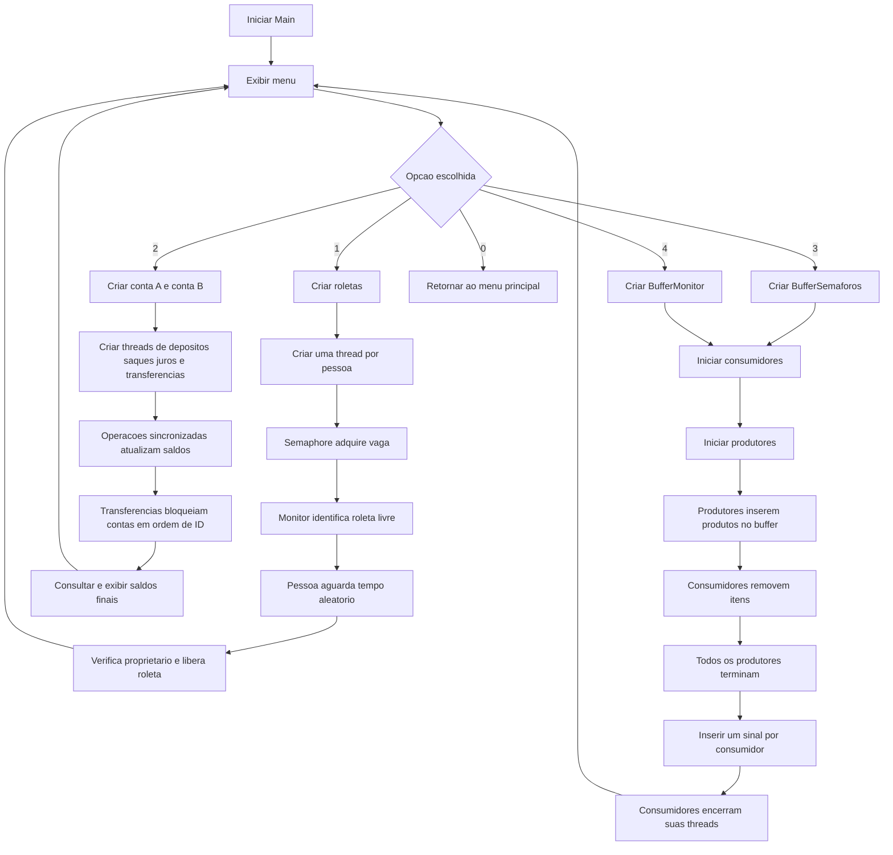

# Exercício 4 - Problemas Clássicos de Sincronização

## Visão Geral

Esta atividade demonstra problemas clássicos de programação concorrente em Java. A solução apresenta quatro demonstrações interativas: controle de acesso a roletas com semáforo, operações concorrentes em contas bancárias, produtor/consumidor com semáforos e produtor/consumidor com monitor. O objetivo é exercitar exclusão mútua, coordenação entre threads e prevenção de condições de corrida.

## Tecnologias e Ferramentas

- Java;
- API padrão do Java;
- `Thread` e `Runnable`;
- `java.util.concurrent.Semaphore`;
- `synchronized`, `wait()` e `notifyAll()`;
- `java.math.BigDecimal`;
- `java.util.ArrayDeque` e `java.util.Queue`;
- `Scanner` para entrada interativa;
- Compilador `javac` e máquina virtual `java`.

Não há gerenciador de dependências ou framework externo configurado no projeto.

## Como foi Solucionado

### Menu e coordenação das demonstrações

A classe `Main`, localizada no pacote `app`, apresenta um menu com as opções de execução. Ela recebe opcionalmente a quantidade de roletas e pessoas pelos argumentos da linha de comando; os valores padrões são 3 roletas e 10 pessoas.

O método `main` inicia o menu e mantém o mesmo objeto `Scanner` durante a interação, evitando que várias leituras concorram pela entrada padrão. As demais demonstrações utilizam listas de threads e os métodos auxiliares `iniciarThreads`, `aguardarThreads` e `interromperThreads` para iniciar, aguardar o término e cancelar threads ainda ativas.

### 4.a - Roletas

A classe `Roletas` combina um `Semaphore` com um array de proprietários:

- o semáforo limita o número de pessoas que podem ocupar roletas;
- o método `entrar()` adquire uma vaga, procura uma roleta livre e registra a thread proprietária;
- o monitor criado pelo bloco `synchronized(proprietarios)` protege a busca e a atualização do array;
- o método `sair()` verifica se a thread que tenta sair é a mesma que ocupou a roleta e devolve a vaga ao semáforo;
- se uma thread obtiver uma permissão e nenhuma roleta estiver livre, ela devolve a permissão antes de lançar uma exceção.

Na classe `Main`, uma thread é criada para cada pessoa. A thread ocupa uma roleta, aguarda um intervalo aleatório entre 250 e 750 ms e, em seguida, libera a roleta. O bloco `finally` garante a liberação em caso de interrupção.

### 4.b - Contas bancárias

A classe `ContaBancaria` representa uma conta compartilhada por threads. A `id` única é gerada por `AtomicLong`, enquanto `identificador` define o nome exibido e `saldo` guarda o valor monetário em `BigDecimal`.

Os métodos `depositar`, `sacar`, `creditarJuros` e `getSaldo` são sincronizados com `synchronized`. Isso transforma cada operação de leitura ou alteração em uma região crítica da própria conta. Os valores são normalizados para duas casas decimais com `HALF_UP`, e os métodos validam entradas positivas ou não negativas.

As transferências são implementadas pelo método estático `transferir`. Para evitar deadlock em transferências simultâneas em sentidos opostos, as contas são bloqueadas sempre pela ordem crescente do identificador interno. Dentro dos dois bloqueios, o código verifica o saldo, retira da origem e credita no destino como uma única operação lógica.

### 4.c - Produtor/Consumidor

As classes `Produtor` e `Consumidor` implementam `Runnable`. O `Produtor` cria uma quantidade fixa de objetos `Produto` e os envia ao `Buffer`. O `Consumidor` remove itens em um loop até receber o objeto especial criado por `Produto.sinalDeEncerramento()`.

A interface `Buffer` define as operações `inserir` e `remover`, permitindo que a demonstração da classe `Main` use a mesma lógica com duas implementações:

- `BufferSemaforos` usa três semáforos: `espacosVazios` controla a capacidade, `itensDisponiveis` controla os itens produzidos e `mutex` protege a fila `ArrayDeque`;
- `BufferMonitor` protege a fila com `synchronized`, aguarda condições usando `wait()` em loops `while` e sinaliza alterações com `notifyAll()`.

O fluxo coordenado pela classe `Main` inicia os consumidores, inicia os produtores, aguarda todos os produtores terminarem e, em seguida, envia um sinal de encerramento por consumidor. Os sinais são inseridos no buffer como produtos especiais. Assim, cada consumidor recebe uma notificação de término quando suas operações são finalizadas.

## Diagrama da Solução



## Como Executar

Execute os comandos a partir da raiz do repositório. É necessário ter Java e JDK configurados no `PATH`.

Verifique os comandos disponíveis:

```powershell
java -version
javac -version
```

Compile todos os arquivos do Exercício 4:

```powershell
$fontes = Get-ChildItem 'src\main\java\br\edu\sistemasdistribuidos\exercicio04problemasclassicos' -Recurse -Filter '*.java' |
  ForEach-Object { $_.FullName }

javac -encoding UTF-8 -d out $fontes
```

Execute a classe principal:

```powershell
java -cp out br.edu.sistemasdistribuidos.exercicio04problemasclassicos.app.Main
```

É possível informar a quantidade de roletas e pessoas:

```powershell
java -cp out br.edu.sistemasdistribuidos.exercicio04problemasclassicos.app.Main 2 8
```

No menu interativo, escolha as opções:

- `1` para roletas;
- `2` para contas bancárias;
- `3` para produtor/consumidor com semáforos;
- `4` para produtor/consumidor com monitor;
- `0` para sair.
